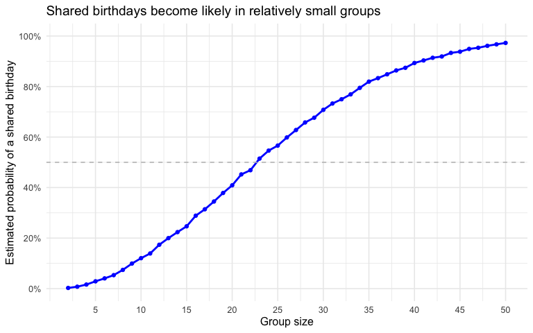
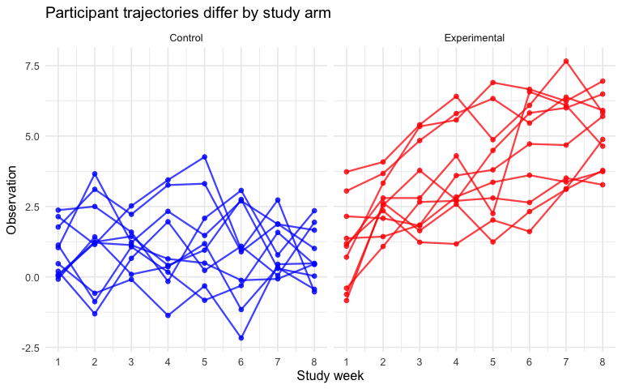
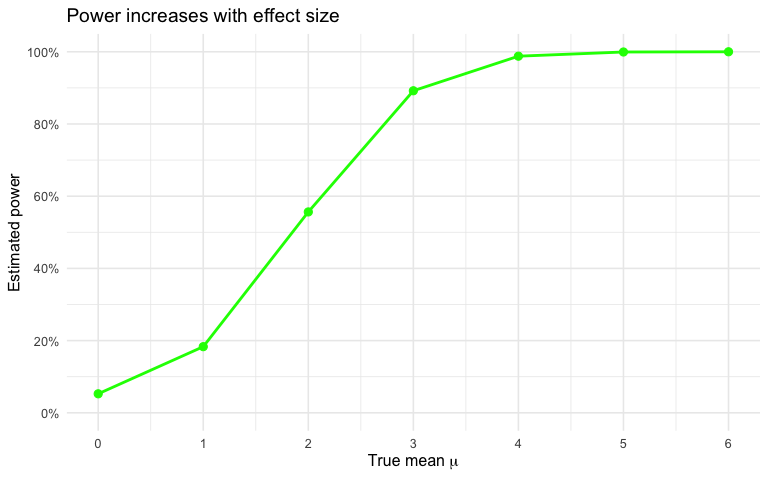
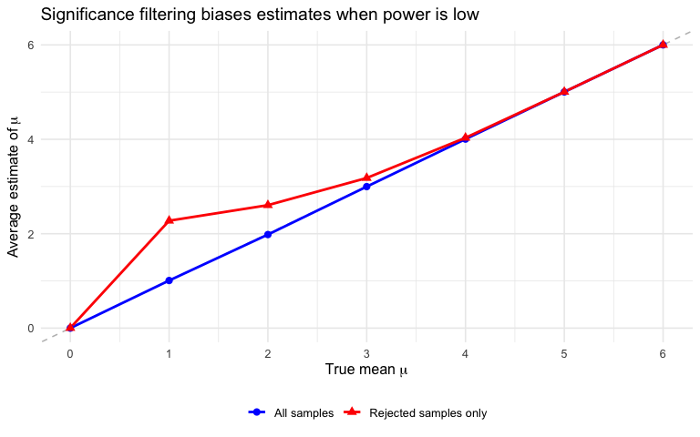

P8105 Homework 5
================
Houson Lin (hl4104)
2026-11-18

# Problem 1

Function written in class

``` r
source("Source/birthday_repeated.R")

birthday_repeated(23)
```

    ## [1] TRUE

Simulation

``` r
birthday_results = expand_grid(
  sample_size = 2:50,
  iteration = 1:10000
) |>
  mutate(
    repeated = map_lgl(sample_size, birthday_repeated)
  ) |>
  group_by(sample_size) |>
  summarize(
    probability = mean(repeated),
    .groups = "drop"
  )

birthday_results
```

    ## # A tibble: 49 × 2
    ##    sample_size probability
    ##          <int>       <dbl>
    ##  1           2      0.0026
    ##  2           3      0.0075
    ##  3           4      0.016 
    ##  4           5      0.0288
    ##  5           6      0.0404
    ##  6           7      0.0533
    ##  7           8      0.0741
    ##  8           9      0.0992
    ##  9          10      0.120 
    ## 10          11      0.139 
    ## # ℹ 39 more rows

``` r
birthday_results |>
  ggplot(aes(x = sample_size, y = probability)) +
  geom_line(color = "blue", linewidth = 1) +
  geom_point(color = "blue", size = 1.5) +
  geom_hline(yintercept = 0.5, linetype = "dashed", color = "gray") +
  scale_x_continuous(breaks = seq(5, 50, by = 5)) +
  scale_y_continuous(
    limits = c(0, 1),
    breaks = seq(0, 1, by = 0.2),
    labels = scales::label_percent()
  ) +
  labs(
    title = "Shared birthdays become likely in relatively small groups",
    x = "Group size",
    y = "Estimated probability of a shared birthday"
  )
```

<div class="figure">


<p class="caption">

Estimated probability of at least one shared birthday by group size.
</p>

</div>

The probability increases nonlinearly as group size increases. It is
already approximately 51.5% for 23 people and exceeds 50% around this
group size. The increase is faster than intuition may suggest because
every pair of people creates another opportunity for a match; the number
of distinct pairs is $n(n-1)/2$, rather than merely $n$.

# Problem 2

list.files

``` r
study_files = tibble(
  file_name = list.files(
    path = "data",
    pattern = "^(con|exp)_\\d{2}\\.csv$",
    full.names = TRUE
  )
) |>
  mutate(
    observations = map(
      file_name,
      \(path) read_csv(path)
    )
  )

study_files
```

    ## # A tibble: 20 × 2
    ##    file_name       observations      
    ##    <chr>           <list>            
    ##  1 data/con_01.csv <spc_tbl_ [1 × 8]>
    ##  2 data/con_02.csv <spc_tbl_ [1 × 8]>
    ##  3 data/con_03.csv <spc_tbl_ [1 × 8]>
    ##  4 data/con_04.csv <spc_tbl_ [1 × 8]>
    ##  5 data/con_05.csv <spc_tbl_ [1 × 8]>
    ##  6 data/con_06.csv <spc_tbl_ [1 × 8]>
    ##  7 data/con_07.csv <spc_tbl_ [1 × 8]>
    ##  8 data/con_08.csv <spc_tbl_ [1 × 8]>
    ##  9 data/con_09.csv <spc_tbl_ [1 × 8]>
    ## 10 data/con_10.csv <spc_tbl_ [1 × 8]>
    ## 11 data/exp_01.csv <spc_tbl_ [1 × 8]>
    ## 12 data/exp_02.csv <spc_tbl_ [1 × 8]>
    ## 13 data/exp_03.csv <spc_tbl_ [1 × 8]>
    ## 14 data/exp_04.csv <spc_tbl_ [1 × 8]>
    ## 15 data/exp_05.csv <spc_tbl_ [1 × 8]>
    ## 16 data/exp_06.csv <spc_tbl_ [1 × 8]>
    ## 17 data/exp_07.csv <spc_tbl_ [1 × 8]>
    ## 18 data/exp_08.csv <spc_tbl_ [1 × 8]>
    ## 19 data/exp_09.csv <spc_tbl_ [1 × 8]>
    ## 20 data/exp_10.csv <spc_tbl_ [1 × 8]>

extract names, select, pivot_longer

``` r
study_tidy = study_files |>
  mutate(
    file_id = str_remove(basename(file_name), "\\.csv$"),
    arm_code = str_extract(file_id, "^[a-z]+"),
    subject_number = str_extract(file_id, "\\d+$"),
    arm = recode(
      arm_code,
      con = "Control",
      exp = "Experimental"
    ),
    subject_id = str_c(arm_code, subject_number, sep = "_")
  ) |>
  select(subject_id, arm, observations) |>
  unnest(observations) |>
  pivot_longer(
    cols = starts_with("week_"),
    names_to = "week",
    names_prefix = "week_",
    values_to = "observation",
    names_transform = list(week = as.integer)
  ) |>
  arrange(arm, subject_id, week)

study_tidy
```

    ## # A tibble: 160 × 4
    ##    subject_id arm      week observation
    ##    <chr>      <chr>   <int>       <dbl>
    ##  1 con_01     Control     1        0.2 
    ##  2 con_01     Control     2       -1.31
    ##  3 con_01     Control     3        0.66
    ##  4 con_01     Control     4        1.96
    ##  5 con_01     Control     5        0.23
    ##  6 con_01     Control     6        1.09
    ##  7 con_01     Control     7        0.05
    ##  8 con_01     Control     8        1.94
    ##  9 con_02     Control     1        1.13
    ## 10 con_02     Control     2       -0.88
    ## # ℹ 150 more rows

The checks below verify that there are 20 participants, eight weekly
observations per participant, and no missing outcome values.

``` r
study_tidy |>
  summarize(
    participants = n_distinct(subject_id),
    weeks = n_distinct(week),
    rows = n(),
    missing_observations = sum(is.na(observation))
  )
```

    ## # A tibble: 1 × 4
    ##   participants weeks  rows missing_observations
    ##          <int> <int> <int>                <int>
    ## 1           20     8   160                    0

``` r
study_tidy |>
  ggplot(
    aes(
      x = week,
      y = observation,
      group = subject_id,
      color = arm
    )
  ) +
  geom_line(alpha = 0.75, linewidth = 0.8) +
  geom_point(alpha = 0.8, size = 1.6) +
  facet_grid(. ~ arm) +
  scale_x_continuous(breaks = 1:8) +
  scale_color_manual(
    values = c("Control" = "blue", "Experimental" = "red")
  ) +
  labs(
    title = "Participant trajectories differ by study arm",
    x = "Study week",
    y = "Observation",
    color = "Study arm"
  ) +
  theme(legend.position = "none")
```

<div class="figure">


<p class="caption">

Individual outcome trajectories over eight weeks, separated by study
arm.
</p>

</div>

mean observation in each arm and week

``` r
weekly_summary <- study_tidy |>
  group_by(arm, week) |>
  summarize(
    mean_observation = mean(observation),
    sd_observation = sd(observation),
    .groups = "drop"
  )

weekly_summary
```

    ## # A tibble: 16 × 4
    ##    arm           week mean_observation sd_observation
    ##    <chr>        <int>            <dbl>          <dbl>
    ##  1 Control          1            0.915          0.918
    ##  2 Control          2            1.15           1.67 
    ##  3 Control          3            1.18           0.830
    ##  4 Control          4            1.10           1.57 
    ##  5 Control          5            1.28           1.58 
    ##  6 Control          6            0.771          1.75 
    ##  7 Control          7            0.99           0.954
    ##  8 Control          8            0.74           0.983
    ##  9 Experimental     1            1.14           1.53 
    ## 10 Experimental     2            2.60           0.938
    ## 11 Experimental     3            3.14           1.60 
    ## 12 Experimental     4            3.77           1.70 
    ## 13 Experimental     5            3.81           1.85 
    ## 14 Experimental     6            4.55           1.87 
    ## 15 Experimental     7            5.02           1.66 
    ## 16 Experimental     8            5.12           1.25

The control trajectories fluctuate around a relatively stable level,
with a modest decline by the final weeks. In contrast, most participants
in the experimental arm show increasing outcomes over time. The two
groups are fairly similar near the beginning, but their trajectories
separate as follow-up continues; by week 8, the experimental group mean
is 5.12, compared with 0.74 in the control group. This descriptive plot
suggests a positive experimental-arm effect that grows over time,
although a formal longitudinal analysis would be needed for statistical
inference.

# Problem 3

``` r
source("Source/simulate_t_test.R")

simulate_t_test(mu = 0)
```

    ## # A tibble: 1 × 2
    ##   estimate p.value
    ##      <dbl>   <dbl>
    ## 1    0.204   0.827

5000 datasets under the null value

``` r
null_results <- map_dfr(
  1:5000,
  \(simulation) simulate_t_test(mu = 0),
  .id = "simulation"
)

null_results
```

    ## # A tibble: 5,000 × 3
    ##    simulation estimate p.value
    ##    <chr>         <dbl>   <dbl>
    ##  1 1           1.57     0.198 
    ##  2 2          -0.570    0.531 
    ##  3 3          -0.00994  0.991 
    ##  4 4          -1.19     0.207 
    ##  5 5          -0.927    0.301 
    ##  6 6          -2.46     0.0120
    ##  7 7           1.50     0.0529
    ##  8 8           0.704    0.364 
    ##  9 9          -0.971    0.302 
    ## 10 10          2.16     0.0341
    ## # ℹ 4,990 more rows

Type I error rate under alpha = 0.05

``` r
null_results |>
  summarize(
    rejection_proportion = mean(p.value < 0.05)
  )
```

    ## # A tibble: 1 × 1
    ##   rejection_proportion
    ##                  <dbl>
    ## 1                0.051

The estimated rejection proportion is 5.1%, which is close to the
nominal 5% Type I error rate.

Now repeat the 5,000-dataset simulation for each integer value of $\mu$
from 0 through 6.

``` r
simulation_results = tibble(mu = 0:6) |>
  mutate(
    results = map(
      mu,
      \(true_mu) map_dfr(
        1:5000,
        \(simulation) simulate_t_test(mu = true_mu)
      )
    )
  ) |>
  unnest(results) |>
  mutate(rejected = p.value < 0.05)

simulation_results
```

    ## # A tibble: 35,000 × 4
    ##       mu estimate p.value rejected
    ##    <int>    <dbl>   <dbl> <lgl>   
    ##  1     0    1.30   0.188  FALSE   
    ##  2     0    0.277  0.778  FALSE   
    ##  3     0    0.371  0.696  FALSE   
    ##  4     0    0.811  0.263  FALSE   
    ##  5     0   -1.08   0.183  FALSE   
    ##  6     0   -0.917  0.325  FALSE   
    ##  7     0   -0.496  0.563  FALSE   
    ##  8     0   -0.173  0.869  FALSE   
    ##  9     0   -0.112  0.919  FALSE   
    ## 10     0    1.55   0.0891 FALSE   
    ## # ℹ 34,990 more rows

The power at each true mean is the proportion of simulations in which
the null hypothesis is rejected.

``` r
power_results = simulation_results |>
  group_by(mu) |>
  summarize(
    power = mean(rejected),
    .groups = "drop"
  )

power_results
```

    ## # A tibble: 7 × 2
    ##      mu  power
    ##   <int>  <dbl>
    ## 1     0 0.0526
    ## 2     1 0.183 
    ## 3     2 0.556 
    ## 4     3 0.892 
    ## 5     4 0.988 
    ## 6     5 0.999 
    ## 7     6 1

``` r
power_results |>
  ggplot(aes(x = mu, y = power)) +
  geom_line(color = "green", linewidth = 1) +
  geom_point(color = "green", size = 2.5) +
  scale_x_continuous(breaks = 0:6) +
  scale_y_continuous(
    limits = c(0, 1),
    breaks = seq(0, 1, by = 0.2),
    labels = scales::label_percent()
  ) +
  labs(
    title = "Power increases with effect size",
    x = expression("True mean " * mu),
    y = "Estimated power"
  )
```

<div class="figure">


<p class="caption">

Estimated power of the two-sided one-sample t-test across true mean
values.
</p>

</div>

Power increases as the true mean moves farther from the null value of
zero. With $n$ and $\sigma$ fixed, a larger effect is easier to
distinguish from sampling variation. At $\mu=0$, the rejection
proportion is approximately the 5% Type I error rate; by the largest
effect sizes considered, power approaches 100%.

Compare the average estimate across all simulations with the average
estimate restricted to simulations in which the null was rejected.

``` r
estimate_results = simulation_results |>
  group_by(mu) |>
  summarize(
    mean_estimate_all = mean(estimate),
    mean_estimate_rejected = mean(estimate[rejected]),
    .groups = "drop"
  ) |>
  pivot_longer(
    cols = starts_with("mean_estimate"),
    names_to = "sample_set",
    values_to = "mean_estimate"
  ) |>
  mutate(
    sample_set = recode(
      sample_set,
      mean_estimate_all = "All samples",
      mean_estimate_rejected = "Rejected samples only"
    )
  )

estimate_results
```

    ## # A tibble: 14 × 3
    ##       mu sample_set            mean_estimate
    ##    <int> <chr>                         <dbl>
    ##  1     0 All samples                0.000727
    ##  2     0 Rejected samples only      0.00331 
    ##  3     1 All samples                1.01    
    ##  4     1 Rejected samples only      2.28    
    ##  5     2 All samples                1.98    
    ##  6     2 Rejected samples only      2.60    
    ##  7     3 All samples                3.00    
    ##  8     3 Rejected samples only      3.18    
    ##  9     4 All samples                4.00    
    ## 10     4 Rejected samples only      4.03    
    ## 11     5 All samples                5.00    
    ## 12     5 Rejected samples only      5.00    
    ## 13     6 All samples                6.00    
    ## 14     6 Rejected samples only      6.00

``` r
estimate_results |>
  ggplot(
    aes(
      x = mu,
      y = mean_estimate,
      color = sample_set,
      shape = sample_set
    )
  ) +
  geom_abline(
    intercept = 0,
    slope = 1,
    linetype = "dashed",
    color = "gray"
  ) +
  geom_line(linewidth = 1) +
  geom_point(size = 2.5) +
  scale_x_continuous(breaks = 0:6) +
  scale_color_manual(
    values = c(
      "All samples" = "blue",
      "Rejected samples only" = "red"
    )
  ) +
  labs(
    title = "Significance filtering biases estimates when power is low",
    x = expression("True mean " * mu),
    y = expression("Average estimate of " * mu),
    color = NULL,
    shape = NULL
  ) +
  theme(legend.position = "bottom")
```

<div class="figure">


<p class="caption">

Average estimated mean using all simulations and using only simulations
with a rejected null hypothesis.
</p>

</div>

Across all simulations, the average estimate is approximately equal to
the true $\mu$, reflecting that the sample mean is an unbiased
estimator. Among rejected tests only, however, estimates tend to be
farther from zero than the true value when power is low or moderate.
Rejection selects samples whose estimates are large enough relative to
their standard errors to cross the significance threshold, so unusually
large estimates are overrepresented. This is a form of selection bias,
sometimes called the winner’s curse. As the true effect and power
increase, nearly every sample is rejected, so the conditional average
approaches the unconditional average and the true value. At $\mu=0$,
significant positive and negative estimates are selected symmetrically,
so their signed average remains near zero even though their absolute
magnitudes are unusually large.
